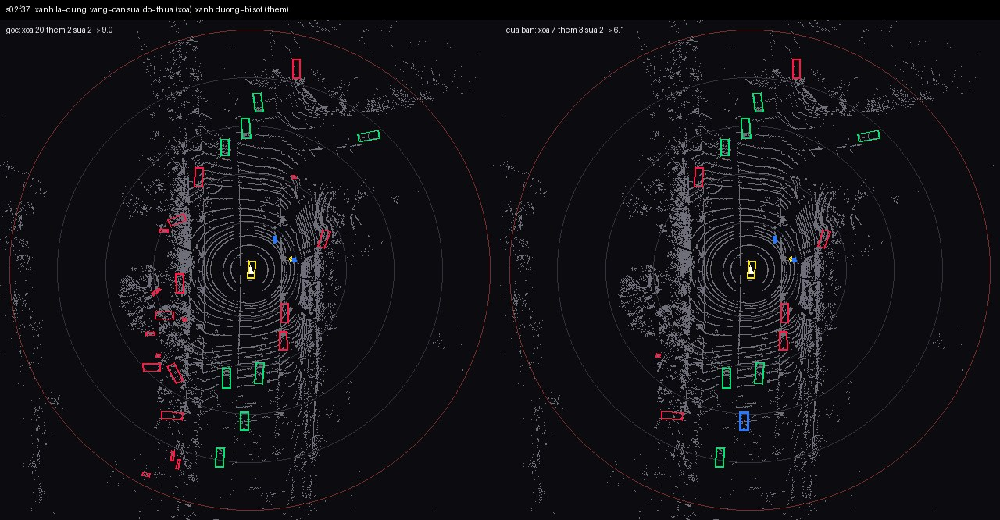

# Báo cáo Day 14 — Nguyen Thanh Tai — 2A202603038

- Mã học viên dùng với `--student`: `038`
- `seed_tag` trong `frames_A.txt`: `393590736f`

## 1. Dự đoán trước sweep (bước 5b)

Ghi **trước** khi chạy `scripts/pp_sweep.py`, rồi commit và push ngay (lịch sử commit là bằng chứng thời điểm viết). Không sửa phần này sau khi có kết quả.

- Tham số tôi nghĩ giảm công sửa nhiều nhất: score_thr, thử tăng score_thr vừa phải từ 0.1 lên 0.2 hoặc 0.3. Bởi vì baseline có 45 box phải xóa và 7 box phải thêm, nên việc lọc bớt một số dự đoán yếu có thể giảm phần box thừa
- Vì sao (nhìn ảnh BEV tập A: box thừa nhiều hay box sót nhiều?): vì box thừa có vẻ nhiều hơn box sót. Số đo A là xóa 45, thêm 7; ảnh BEV cũng có nhiều box dự đoán chen quanh các cụm xe và ven đường. Vì vậy, có cơ sở để thử lọc bớt dự đoán yếu. Lọc quá mạnh vẫn có thể làm mất vật thể thật, nhất là vật thể nhỏ hoặc thưa điểm.

## 2. Tập A: sửa tay và tune

| Cấu hình | Xóa | Thêm | Sửa | Chi phí |
|---|---:|---:|---:|---:|
| Gốc | 45 | 7 | 4 | 22.5 |
| `best_config.json` | 20 | 9 | 4 | 17.0 |

- Tham số thay đổi trong `best_config.json`: `score_thr` tăng từ 0.1 lên 0.4; `min_points` là 0, giữ mức gốc.
- Kết quả leave-one-out: bỏ `s02f37`, cấu hình được chọn là `score_thr=0.3, min_points=5`, chi phí 7.2 (tốt nhất riêng frame là 6.1); bỏ `s04f12`, chọn `score_thr=0.4, min_points=0`, chi phí 2.9 (tốt nhất 2.9); bỏ `s05f12`, chọn `score_thr=0.4, min_points=0`, chi phí 8.0 (tốt nhất 7.0).
- Độ ổn định và lựa chọn: cấu hình chưa ổn định hoàn toàn giữa các fold vì một fold chọn `score_thr=0.3, min_points=5`, còn hai fold chọn `0.4, 0`. Chi phí leave-one-out cao hơn mức tốt nhất riêng từng frame từ 0 đến 1.1. Tôi dùng `best_config.json` làm điểm xuất phát cho tập B vì cấu hình `score_thr=0.4, min_points=0` đạt chi phí tổng thấp nhất trong sweep (17.0); kết quả chỉ dựa trên 3 frame tập A nên vẫn có nguy cơ overfit.

## 3. Trước/sau (bước 8)

- `scripts/pp_compare.py` báo giảm 24% công sửa trên tập A (tổng chi phí từ 22.5 xuống 17.0).
- Đối chiếu số box: cấu hình gốc xóa 45, thêm 7, sửa 4; cấu hình đã tune xóa 20, thêm 9, sửa 4. Sweep chọn `score_thr=0.4`, `min_points=0`, còn mục 1 dự đoán `score_thr=0.2` hoặc `0.3`.
- Kết luận dự đoán ở mục 1 là đúng và lý do ở hai frame đầu, ảnh tuned có ít box đỏ hơn rõ rệt, trong khi số box xanh dương chỉ tăng nhẹ ở s02f37. Ở s05f12, số box đỏ không giảm nhưng box xanh dương tăng, nên chi phí frame này cao hơn 1 điểm. Tổng thể, tuned giảm 25 box phải xóa, tăng 2 box phải thêm, số box sửa giữ nguyên; chi phí giảm từ 22.5 xuống 17.0. sweep chọn score_thr=0.4, cao hơn mức 0.2–0.3. Điều này cho thấy lọc mạnh hơn có lợi ở hai frame nhưng cũng có thể làm sót vật thể ở frame khác

## 4. Tập B

Số đo từ `scripts/pp_prelabel.py --frames d14_038/frames_B.txt --config d14_038/best_config.json --gt d14_038/ref_B.json`:

| Xóa | Thêm | Sửa | Chi phí |
|---:|---:|---:|---:|
| 102 | 11 | 1 | 42.1 |

- Loại box tốn công sửa nhất ở tập B: Cyclist

## 5. Giới hạn

- Sweep chỉ tune trên 3 frame tập A nên cấu hình tốt nhất có thể overfit các frame này và chưa chắc tổng quát cho các sequence khác.
- PointPillars được huấn luyện trước trên KITTI, khác miền dữ liệu VF và không có lớp Truck/Bus gốc; dự đoán các loại xe này cần được kiểm tra thủ công.
- Chi phí sửa là công thức có trọng số (0.3·xóa + 1.0·thêm + 0.5·sửa), chỉ tính đối tượng trong phạm vi 50 m; đây không phải thời gian gán nhãn thực tế.
